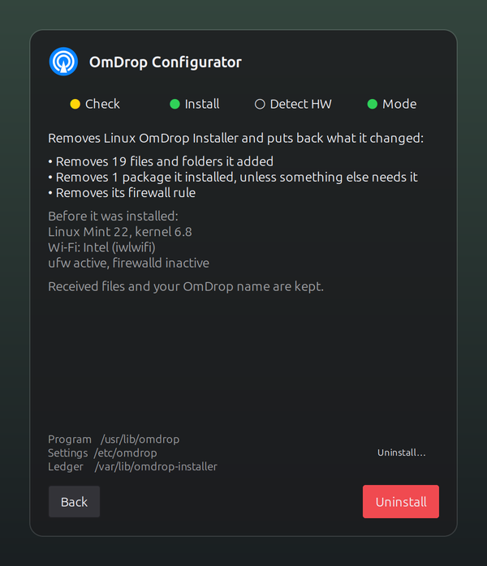
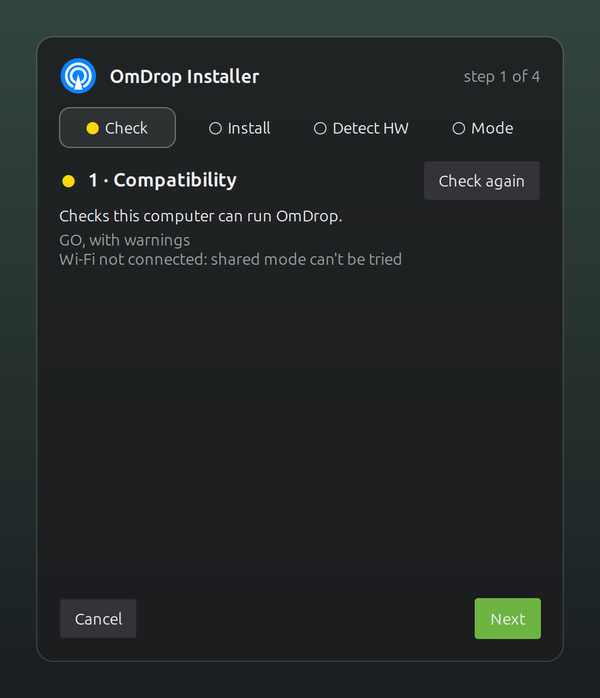
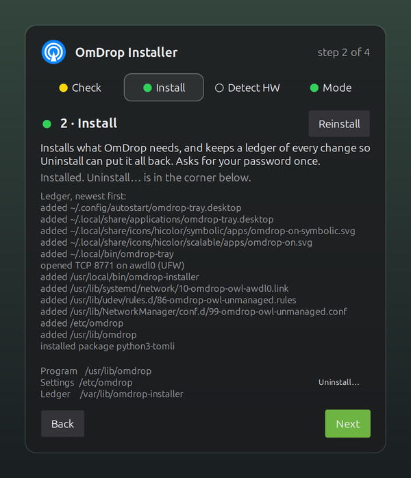
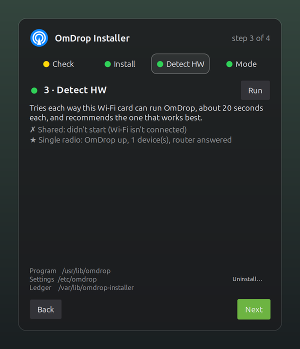
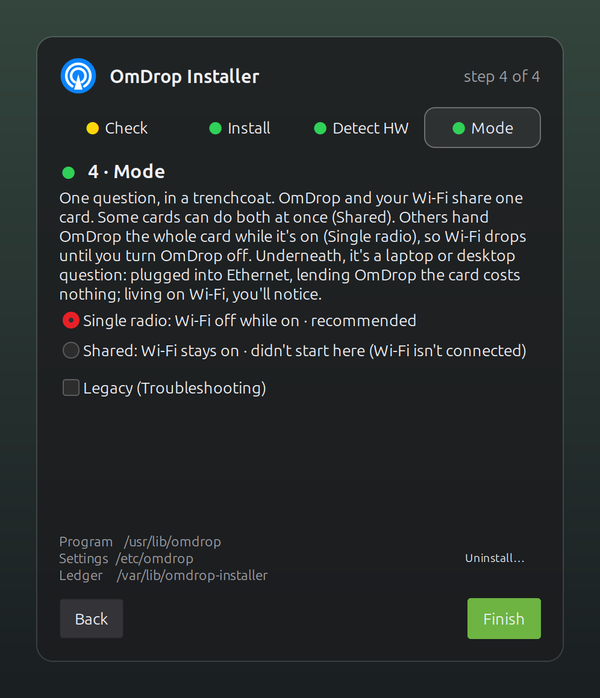
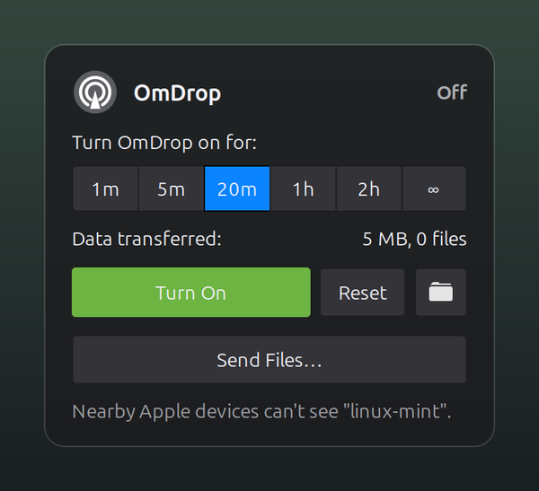
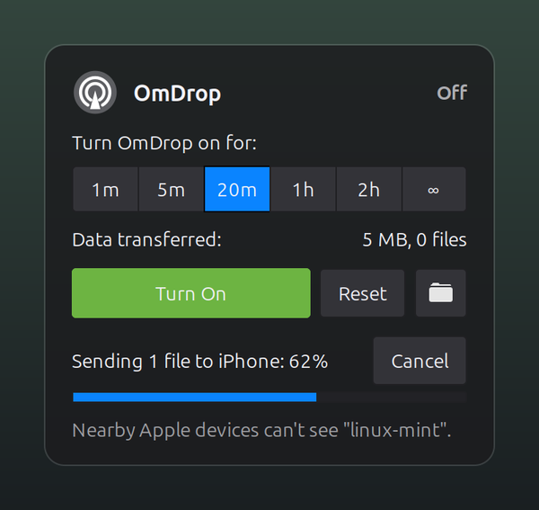

# OmDrop for Linux Mint

**Unofficial Linux Mint tester build** of [T4T5](https://github.com/t4t5)'s
[omdrop-owl](https://github.com/t4t5/omdrop-owl): send files between an iPhone
and a Linux Mint PC the way two Apple devices share files, on ordinary PC
Wi-Fi cards, from an icon in your panel.

## Safe to try, easy to take back

Before you install anything, here is how you get rid of it. The installer
writes down every change it makes as it makes it: each file and folder it
adds, the original of anything it replaces, each package it installs, and
the firewall rule it adds if you use a firewall. It also notes what your
machine looked like before it started.

Uninstall reads that ledger backwards and puts things back: what it added
goes, what it replaced comes back, and the packages it installed are removed
unless something else on your system now needs them. Your received files and
your OmDrop name stay.

<p align="center"></p>

You don't have to take that on trust. `omdrop-installer ledger` prints the
whole record at any time, and the uninstall page shows it before you confirm.
To remove it: right-click the OmDrop icon, **Configure…**, **Uninstall…**,
then **Uninstall**. Or, in a terminal:

```sh
omdrop-installer uninstall
```

## Install

Open a terminal on Linux Mint, paste this, and press Enter:

```sh
curl -fsSL https://raw.githubusercontent.com/kwilliam208/mint-omdrop-T4T5/main/install.sh | sh
```

Run it as yourself, not with `sudo`; it asks for your password once, when it
needs it. You need a Wi-Fi card with monitor mode, which most Intel, MediaTek
and Realtek laptop cards have. Compatibility (step 1) checks that before
anything is installed. It's been tried most on Linux Mint 22 (Cinnamon), and
should work on Mint's MATE and Xfce editions and on other Ubuntu and Debian
based systems.

## What happens next


An OmDrop icon appears in your panel's tray, sized and coloured to match the
icons beside it. Click it, and the installer opens right there, one step a
page.

 

**1 · Compatibility** checks your Wi-Fi card, NetworkManager and the rest,
and says GO or NO-GO before it changes anything.

**2 · Install** asks for your password once, then lists every change it
made, newest first; Uninstall appears in the corner as soon as it's done.

 

**3 · Detect HW** tries each way your card can run OmDrop, about 20 seconds
each, and recommends the one that works best on your machine.

**4 · Mode** lets you choose how OmDrop shares your Wi-Fi card, with the
recommendation already picked and a plain explanation of the trade-off.

 

From then on, click the icon to make this PC visible to nearby iPhones for a
minute, an hour, or until you turn it off.

**Send Files…** checks the files you pick and sends them to one or more
nearby devices.


While it sends, the icon fills a blue ring, so you can watch it without
opening anything.

On the iPhone, set receiving to **Everyone for 10 Minutes** (Settings ›
General) to send to or receive from this PC. Everything else (commands, supported Wi-Fi cards, how
it works, known issues) is in [docs/DETAILS.md](docs/DETAILS.md).

## Built by the open-source community

OmDrop on Linux exists because these people and projects did the work in
the open:

- **[omdrop-owl](https://github.com/t4t5/omdrop-owl)**, by
  [T4T5](https://github.com/t4t5) and its
  [contributors](https://github.com/t4t5/omdrop-owl/graphs/contributors),
  including [kmod-midori](https://github.com/kmod-midori)'s active-monitor
  mode for MediaTek cards. The base of everything here.
- **[OWL](https://github.com/seemoo-lab/owl)**, the open implementation of
  AWDL (the Wi-Fi link iPhones share files over), from
  [seemoo-lab](https://github.com/seemoo-lab)'s research at TU Darmstadt.
  Built here from [jedbillyb](https://github.com/jedbillyb)'s
  [fork](https://github.com/jedbillyb/owl).
- **[omdrop-awdl](https://github.com/brentkearney/omdrop-awdl)** and the
  **[omdrop plugin](https://github.com/netmojo-systems/omdrop-plugin)**, by
  [brentkearney](https://github.com/brentkearney)
  ([netmojo-systems](https://github.com/netmojo-systems)): the sender,
  receiver and `omdrop` command this works with.
- **[radiotap-library](https://github.com/radiotap/radiotap-library)**, by
  Andy Green and Johannes Berg, which OWL uses to read Wi-Fi frames.
- **[XApp](https://github.com/linuxmint/xapp)**, by
  [Linux Mint](https://github.com/linuxmint), and
  **[Ayatana Indicators](https://github.com/AyatanaIndicators)**, which draw
  the panel icon.

[CREDITS.md](CREDITS.md) says how each is used and under which license.

#### Corporate licenses

<sub>OWL fetches Google's [googletest](https://github.com/google/googletest)
(BSD-3-Clause) as a submodule; it is not built or shipped. AWDL,
iPhone and Apple are trademarks of Apple Inc., used only to say what this
works with. This is an unofficial build, not affiliated with or endorsed by
Apple Inc., Linux Mint, or T4T5's project. omdrop-owl and this project's additions are GPL-3.0-or-later
([LICENSE](LICENSE)).</sub>

## Why this exists

To give back to the open-source and Linux Mint communities that made it
possible: T4T5 and the people above did the hard part, and this tester build
tries to make it something any Mint user can install, try, and remove again
in a few minutes. If it works on your machine, or doesn't, that's worth
hearing either way.

---

Comments, suggestions, or collaborations → Discord → [kwill208](https://discord.com/users/728686067183779930)
